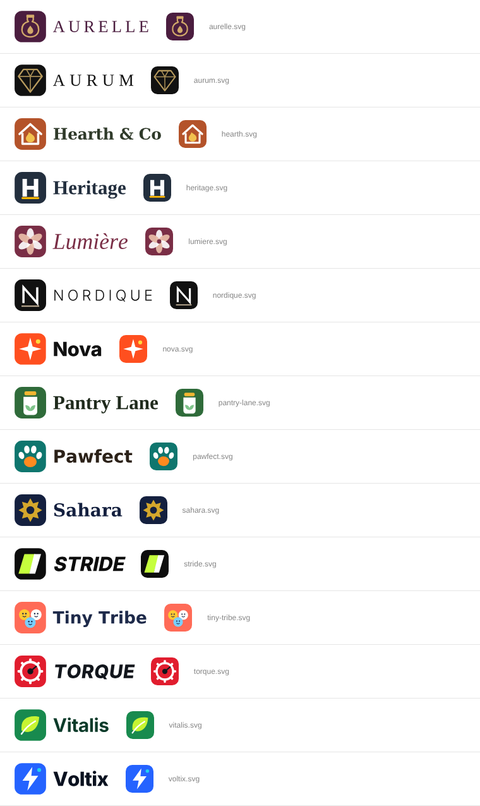

# Storefront names & logos

Every storefront theme has its own name and logo (horizontal lockup + square icon, text converted to paths so no font is needed). Each branch ships its own two files in `public/brand/` and sets them as the defaults in `src/lib/brand.ts`; the owner can replace both in Admin → Appearance (and the setup wizard pre-fills the name).

| Branch | Name | Files |
|---|---|---|
| `claude/storefront-redesign` | Nova | `nova.svg`, `nova-icon.svg` |
| `claude/storefront-arabic` | Sahara | `sahara.svg`, `sahara-icon.svg` |
| `claude/storefront-classic` | Heritage | `heritage.svg`, `heritage-icon.svg` |
| `claude/storefront-beauty` | Lumière | `lumiere.svg`, `lumiere-icon.svg` |
| `claude/storefront-supplements` | Vitalis | `vitalis.svg`, `vitalis-icon.svg` |
| `claude/storefront-fashion` | Nordique | `nordique.svg`, `nordique-icon.svg` |
| `claude/storefront-electronics` | Voltix | `voltix.svg`, `voltix-icon.svg` |
| `claude/storefront-perfume` | Aurelle | `aurelle.svg`, `aurelle-icon.svg` |
| `claude/storefront-home` | Hearth & Co | `hearth.svg`, `hearth-icon.svg` |
| `claude/storefront-food` | Pantry Lane | `pantry-lane.svg`, `pantry-lane-icon.svg` |
| `claude/storefront-kids` | Tiny Tribe | `tiny-tribe.svg`, `tiny-tribe-icon.svg` |
| `claude/storefront-jewelry` | Aurum | `aurum.svg`, `aurum-icon.svg` |
| `claude/storefront-shoes` | Stride | `stride.svg`, `stride-icon.svg` |
| `claude/storefront-auto` | Torque | `torque.svg`, `torque-icon.svg` |
| `claude/storefront-pets` | Pawfect | `pawfect.svg`, `pawfect-icon.svg` |

Regenerate or tweak them with `python3 scripts/brand/gen-logos.py docs/brand` (needs `pip install fonttools`).
